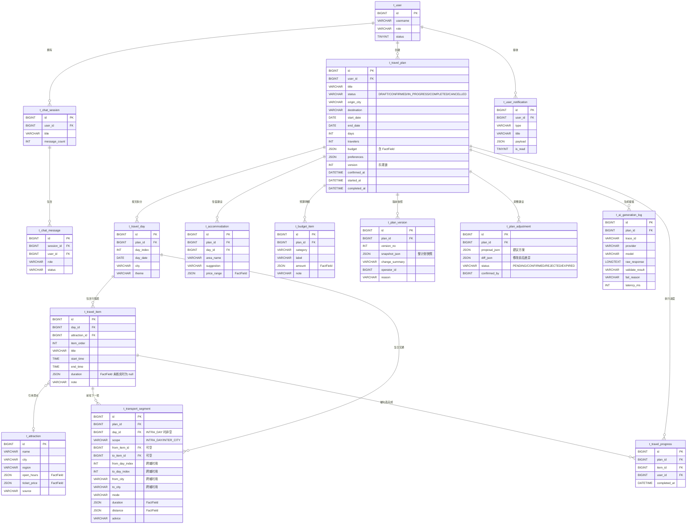

# 04 · 数据模型设计（M1 / M2）

> 状态：草案，待 D-05 确认 ｜ 上位文档：总纲 V1.0 第 5 章、9.4
> 本文件只定义 **M1（计划生成）与 M2（旅行执行）** 所需表；M4+ 的社区 / 分享 / 协作表仅列清单，不提前建表。

## 1. 与现有基线的一致性

Phase 1 已建 3 张表（`sql/01_schema.sql`）：`t_user`、`t_chat_session`、`t_chat_message`。新增表必须沿用同样的约定：

| 约定 | 值 |
|---|---|
| 主键 | `BIGINT`，MyBatis-Plus 雪花 ID（`ASSIGN_ID`） |
| 字符集 | `utf8mb4` / `utf8mb4_general_ci` |
| 审计字段 | `create_time`、`update_time`、`deleted`（逻辑删除） |
| 命名 | 表名 `t_` + 蛇形；字段名蛇形，映射到驼峰 |
| 唯一索引 | 必须包含 `deleted` 字段，否则逻辑删除后无法复用业务键 |
| 时间类型 | `DATETIME`，应用层统一 `Asia/Shanghai` |
| JSON 字段 | MySQL 8 `JSON` 类型，写入前由 Schema 校验 |

> 总纲 5.2 要求「数据库设计完成后必须提供 ER 图和字段说明。未经项目负责人同意，不得随意修改已经确认的核心数据结构」。本文件即为该交付物；变更走第 7 节流程。

## 2. 实体补全清单

总纲 5.1 列了 17 个逻辑实体，但缺少计划本体之外的关键对象。下表标注补全项：

| 实体 | 总纲已列 | 本包补充 | M1/M2 是否建表 |
|---|---|---|---|
| User / UserProfile | ✅ / ✅ | 合并为 `t_user`（Phase 1 已建） | 已有 |
| ChatSession / ChatMessage | ✅ / ✅ | — | 已有 |
| TravelPlan | ✅ | 增加乐观锁 `version`、状态机字段 | ✅ |
| TravelDay | ✅ | — | ✅ |
| TravelItem | ✅ | — | ✅ |
| **Attraction**（景点主数据） | ❌ | ✅ 补全 | ✅（轻量） |
| **TransportSegment**（景点间交通段） | ❌ | ✅ 补全 | ✅ |
| **Accommodation**（住宿建议） | ❌ | ✅ 补全 | ✅ |
| **BudgetItem**（预算明细） | ❌ | ✅ 补全 | ✅ |
| **TravelProgress**（行程项完成记录） | ❌ | ✅ 补全 | ✅ |
| **PlanVersion**（计划版本快照） | ✅ | 明确粒度与内容 | ✅ |
| **PlanAdjustment**（调整建议待确认） | ❌ | ✅ 补全 | ✅ |
| **AiGenerationLog**（AI 原始响应留痕） | ❌ | ✅ 补全 | ✅ |
| UserNotification | ✅ | 提前到 M2 | ✅ |
| TravelArticle / Category / Comment / Like / Favorite | ✅ | — | ❌ M4+ |
| PlanShare / PlanMember / PlanVote | ✅ | — | ❌ M4+ |

**补全理由**（对应上次审阅 G-4）：

- 没有 `Attraction` 表，景点信息只能塞进 `TravelItem` 的自由文本，无法复用、无法标注来源、无法做「待核实」标记。
- 没有 `TransportSegment`，景点间交通只能由 AI 编一段文字，正好踩中总纲「不编造耗时」红线；独立表后可挂 `FactField`。
- 没有 `BudgetItem`，「预算合理性」无从校验，只能是一句自然语言。
- 没有 `PlanAdjustment`，「AI 出建议 → 用户确认」这个流程没有承载实体，容易退化成 AI 直接改正式计划。
- 没有 `AiGenerationLog`，Schema 校验失败时无法排查模型到底吐了什么（R-14 要求保留原始响应）。

## 3. ER 图（M0–M2 核心表）

> `t_budget_item`、`t_accommodation` 结构较简单，见第 4 节文字说明，ER 图中省略属性以控制篇幅。

## 4. 关键表字段说明

### 4.1 `t_travel_plan`（计划主表）

| 字段 | 类型 | 约束 | 说明 |
|---|---|---|---|
| `id` | BIGINT | PK | 雪花 ID |
| `user_id` | BIGINT | NOT NULL, INDEX | 归属用户，越权校验依据 |
| `title` | VARCHAR(100) | NOT NULL | 计划标题 |
| `status` | VARCHAR(20) | NOT NULL, 枚举 | 见第 5 节状态机，**禁止用魔法字符串** |
| `origin_city` / `destination` | VARCHAR(64) | 可空 | 缺失时存 NULL，不存空串 |
| `destinations` | JSON | 可空 | Q-01 新增：全部目的地数组，`destinations[0]` 与 `destination` 一致（由 Java 校验）；列表页仍用 `destination` 筛选，详情页展示全部 |
| `start_date` / `end_date` | DATE | 可空 | 用户未提供时为空，AI 不得臆造 |
| `days` / `travelers` | INT | 可空 | 未知存 NULL（对应 AC-06） |
| `budget` | JSON | | 总额 + 币种 + `FactField` 标记 |
| `preferences` | JSON | | 兴趣、交通、住宿偏好及各项 `source` |
| `version` | INT | NOT NULL DEFAULT 0 | **乐观锁**，每次更新 +1 |
| `confirmed_at` / `started_at` / `completed_at` | DATETIME | 可空 | 状态流转时间戳，用于审计 |
| `create_time` / `update_time` / `deleted` | | | 基类字段 |

**索引**：`idx_user_status(user_id, deleted, status)`、`idx_user_time(user_id, deleted, update_time)`。

### 4.2 `t_travel_day` / `t_travel_item`

- `day_index` 从 1 开始，同一计划内唯一：`uk_plan_day(plan_id, day_index, deleted)`。
- `item_order` 同一天内唯一，前端拖拽调整顺序时批量更新，需在事务内完成。
- `start_time` / `end_time` 为**用户可调整的建议时间**，不是实时数据，不属于 `FactField`；但 `duration`（耗时估算）属于，未接地图工具时 `value=null`。
- `t_travel_item.title` 允许覆盖 `t_attraction.name`（用户可自定义行程项名称）。

### 4.3 `t_attraction`（景点主数据，轻量版）

MVP 只做「名称 + 城市 + 区域 + 待核实的开放时间/票价」，不做完整 POI 库。`open_hours` / `ticket_price` 存 `FactField` JSON，L0 阶段恒为 `value=null, verified=false`。这样将来接入 POI 工具时，只需更新这两列，行程表结构不动。

### 4.4 `t_transport_segment`

`duration` / `distance` 均为 `FactField`。**这是防止 AI 编造「车程 30 分钟」的技术落点**：L0 阶段这两列永远没有值，前端渲染为「耗时待核实」。

Q-04 新增 `scope` 区分两类路段，约束由 Java 保证（两组字段互斥）：

| scope | 必填 | 必须为 NULL | 用途 |
|---|---|---|---|
| `INTRA_DAY` | `day_id` + `from_item_id` / `to_item_id` | `from_day_index` / `to_day_index` / `from_city` / `to_city` | 同一天内景点间交通 |
| `INTER_CITY` | `from_day_index` / `to_day_index` / `from_city` / `to_city` | `day_id` / `from_item_id` / `to_item_id` | 跨天跨城，如「第 2 天成都到乐山」 |

M1 只落 `INTER_CITY` 的 `advice` 文案；`duration` / `distance` 仍恒为 null。索引：`idx_plan_scope(plan_id, scope, deleted)`。

### 4.5 `t_budget_item` / `t_accommodation`

| 表 | 关键字段 |
|---|---|
| `t_budget_item` | `plan_id`, `category`(交通/住宿/餐饮/门票/其他), `amount`(FactField), `note`, `source` |
| `t_accommodation` | `plan_id`, `day_id`, `area_name`, `suggestion`, `price_range`(FactField), `source` |

预算金额在 L0 阶段同样不能是模型编造的精确数字：可以给用户一个**框架性区间并标注为「AI 估算，非实时价格」**，且 `amount.verified=false`。

### 4.6 `t_plan_version`（版本快照）

见第 5 节决策说明。

### 4.7 `t_plan_adjustment`（调整建议）

承载 R-23 / R-24 的流程：`PENDING` → 用户确认 → `CONFIRMED`（由 Java 写正式计划 + 生成新版本 + 发通知），或 `REJECTED` / `EXPIRED`。**AI 只写本表的 `proposal_json`，绝不直接写 `t_travel_plan`。**

### 4.8 `t_ai_generation_log`

`raw_response` 保留模型原始输出（含校验失败样本），`trace_id` 关联全链路日志。敏感信息（用户原文）按需脱敏留存。对应 R-14 与 AC-07。

## 5. 版本快照粒度（D-05）

| 方案 | 说明 | 评价 |
|---|---|---|
| **A. 整计划级 JSON 快照（建议）** | 每次关键修改把整个计划序列化为 `snapshot_json` | 实现简单、回滚无歧义、无需处理跨表依赖；MVP 无多人协作，数据量可控 |
| B. 单日级快照 | 按 `t_travel_day` 分别存版本 | 粒度细但回滚需协调多表，复杂度高，Phase 5 再评估 |
| C. 字段级 diff | 只存变更字段 | 存储最省，但回滚需重放，易出错 |

**建议采用 A**，理由：MVP 的回滚语义是「回到用户确认过的那一版」，整计划快照一次读取即可还原，不需要重放逻辑。Phase 5 引入多人协同编辑后，再评估 B 或 CRDT 方案（总纲 2.5）。

配套约定：

- **E**：当计划从 `DRAFT` 变为 `CONFIRMED`、或用户确认一次调整时，系统应生成一条 `t_plan_version` 记录。
- **U**：`snapshot_json` 写入前必须通过计划 Schema 校验，禁止把未校验内容存入版本表。
- **U**：`version_no` 在同一计划内单调递增，与 `t_travel_plan.version` 保持一致。
- 快照中同样保留 `FactField` 标记，回滚不得把「待核实」变成「已核实」。

## 6. 并发与一致性

- **U**：`t_travel_plan.version` 作为乐观锁；更新时 `WHERE id=? AND version=?`，影响行数为 0 时返回「数据已被修改，请刷新」。
- **U**：计划创建、状态流转、调整确认、批量重排行程项必须在事务内完成（总纲 5.2 第 6 条）。
- **U**：所有列表查询分页，行程项按 `day_id + item_order` 一次性查出，避免 N+1（总纲 8.2）。
- **U**：重要操作（确认、开始、完成、调整、回滚）记录 `operator_id` 与原因，作为审计信息（总纲 5.2 第 10 条）。
- **U**：对外分享不得暴露内部主键（M4+ 设计约束，本阶段预留 `share_token` 字段不使用）。

## 7. DDL 变更流程

对应总纲 9.4「修改数据库前先提供 SQL」、9.2「更改核心业务实体需 C 级确认」：

1. 在 `sql/migration/` 下新增迁移脚本，命名 `V{序号}__{描述}.sql`（由 Flyway 在启动时执行，见 06 第 3 节）。
2. 提交前在本文件更新 ER 图与字段说明。
3. 技术负责人评审；涉及核心实体属 **C 级**，必须等待确认。
4. 先在 dev 执行并验证，再进 test / prod；**禁止直接手工改生产库**。
5. 每个迁移脚本必须有对应的回滚脚本或明确的「不可逆」标注。
6. 禁止在已确认表上直接 `ALTER` 而不留脚本。

## 8. 待确认

| 编号 | 事项 | 级别 | 建议 |
|---|---|---|---|
| D-05 | 版本快照粒度 | B | 采用整计划级 JSON 快照 |
| D-06 | 计划 JSON Schema（决定 `snapshot_json` 结构） | C | 见 05，需先冻结 |
| — | M4+ 社区 / 分享 / 协作表设计 | — | 对应 Phase 4/5 启动时另行出文档 |

> **已落地（2026-11-09）**：`sql/migration/V2__plan_tables.sql` 建出本文件 M1 所需的 9 张表，回滚脚本为 `sql/rollback/U2__plan_tables_rollback.sql`。实际表结构以脚本为准，与本文档的偏差记录如下：
>
> - `t_travel_plan` 增加 `risks`、`ai_note`、`unverified_field_count`（存储模型需要，ER 图未画）
> - `t_travel_item` 增加 `open_hours`、`ticket_price`（M1 中 `attractionId` 恒为 null，若只挂在 `t_attraction` 上则前端拿不到「待核实」占位）
> - `t_transport_segment` 增加 `plan_id`（跨城段可能不属于任何一天，无法只靠 `day_id` 归属）
> - 均不建外键，关联完整性由应用层事务保证，与 Phase 1 的 `t_chat_message` 保持一致
